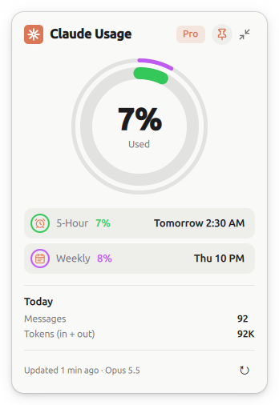
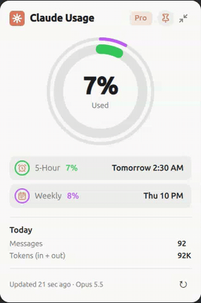
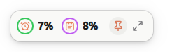

# Claude Usage Monitor

A Qt 6 / QML system tray app for Linux showing Claude subscription usage: the
5-hour and 7-day rate-limit windows, plus today's message and token counts.

## Screenshots

| Full popup | Used ↔ available |
| :---: | :---: |
|  |  |

Collapsed popup, showing just the 5-hour and weekly percentages:



Clicking the gauge sweeps both rings over to the unused part of each window
([MP4 version](assets/gauge-toggle.mp4)).

## Install

On Linux x86_64:

```sh
curl -fsSL https://raw.githubusercontent.com/aminrazeghi/claude-usage-tray/main/install.sh | bash
```

This installs the portable build from the latest release for your user only (no root):

| What | Where |
| --- | --- |
| App (bundled Qt) | `~/.local/share/claude-usage-monitor/` |
| Command | `~/.local/bin/claude-usage-monitor` |
| Icon & menu entry | `~/.local/share/icons/…`, `~/.local/share/applications/` |
| Start on login | `~/.config/autostart/claude-usage-monitor.desktop` |

Run the same command again to update. Options go after `bash -s --`:

```sh
curl -fsSL https://raw.githubusercontent.com/aminrazeghi/claude-usage-tray/main/install.sh | bash -s -- --no-autostart
curl -fsSL https://raw.githubusercontent.com/aminrazeghi/claude-usage-tray/main/install.sh | bash -s -- --version v0.1.2
curl -fsSL https://raw.githubusercontent.com/aminrazeghi/claude-usage-tray/main/install.sh | bash -s -- --uninstall
```

`--no-start` skips launching it after install. The status line needs `jq`, and
on GNOME the tray needs the AppIndicator extension. The installer warns if
either is missing. You can also grab the `.deb`, AppImage or tarball from
[Releases](https://github.com/aminrazeghi/claude-usage-tray/releases).

## How it works

1. On launch the app installs `~/.claude/statusline.sh` and sets
   `statusLine.command` in `~/.claude/settings.json` if none is configured.
2. Claude Code runs the status line after each response, passing session JSON
   on stdin. The script copies `rate_limits.five_hour` / `seven_day`
   (`used_percentage`, `resets_at`) to `/tmp/claude-usage.json`.
3. `UsageWatcher` watches that file (`QFileSystemWatcher` plus a 1 s mtime poll,
   because the script replaces the file atomically) and exposes it to QML.
4. "Today" stats come from an incremental background scan of
   `~/.claude/projects/**/*.jsonl` (unique assistant messages, input + output tokens).

The plan badge is read from `oauthAccount.organizationType` in `~/.claude.json`.

## Build & run

```sh
cmake -S . -B build -G Ninja -DCMAKE_BUILD_TYPE=Release
cmake --build build
./build/claude-usage-monitor
```

Requires Qt ≥ 6.5 (Core, Gui, Qml, Quick, Widgets, Concurrent) and `jq` for the
status line script. On GNOME the tray needs the AppIndicator extension (enabled
by default on Ubuntu).

Build a Debian package locally with `cd build && cpack -G DEB`.

### CI packages

`.github/workflows/build.yml` runs on pushes, PRs and `v*` tags:

- **deb** – built in an `ubuntu:26.04` container against the distro's Qt
  (depends on system Qt ≥ 6.10, so Ubuntu 26.04 / Debian testing or newer).
- **AppImage** – built on Ubuntu 22.04 with Qt 6.8 LTS bundled via linuxdeploy.
- **portable tarball** – the same bundled tree, run with `./claude-usage-monitor/AppRun`.

Pushing a tag like `v1.0.1` attaches all three to a GitHub release.

| Option | Effect |
| --- | --- |
| `--show` | open the popup on startup |
| `--no-setup` | don't touch `~/.claude` |
| `--force-setup` | replace an existing statusLine command (settings are backed up) |
| `--file <path>` | watch another snapshot (also `CLAUDE_USAGE_FILE`, honoured by the script) |
| `--grab <png>` | render the popup to an image and exit |

## Tray clicks

| Click | GNOME (AppIndicator extension) | KDE / other SNI hosts |
| --- | --- | --- |
| Left | menu (single) · usage popup (double) | usage popup |
| Right | menu: Show Usage, Refresh, Quit | same |

GNOME Shell draws the tray menu itself and only forwards double clicks to the
app, so the popup can't open on a single left click there.

In the popup, click the gauge to switch between used and available, and click
a limit's reset time to see the time left instead. The header buttons:

- **Pin** keeps the popup open when you click elsewhere; drag it by any empty
  area to move it. Escape closes it.
- **Collapse / expand** switches to a compact pill showing just the two
  percentages. The choice is remembered in `~/.config/claude-usage-monitor/`.

## Notes

- Under Wayland the app runs through XWayland (`QT_QPA_PLATFORM=xcb`) so the
  popup can position itself; set `QT_QPA_PLATFORM` yourself to override.
- Tray hosts using StatusNotifierItem don't report icon geometry, so the popup
  opens at the top-right of the primary screen.
- Limits only update while Claude Code is running. Once a window's reset time
  passes, it shows 0%.
- If `~/.claude/statusline.sh` already exists and wasn't written by this app,
  it is left alone. The same goes for an existing statusLine command.
